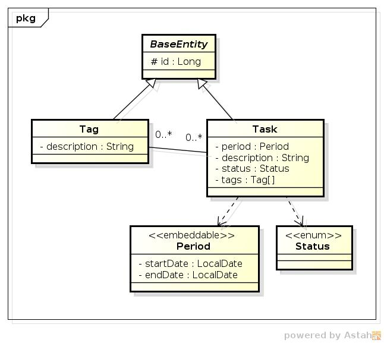

# Sample Specification API

[](https://github.com/fagnerlima/sample-specification-api/actions/workflows/ci.yml)

A sample project for [Spring Specification Tools](https://github.com/fagnerlima/spring-specification-tools).

It exposes the same task search twice: `GET /tasks` builds the query with Spring Specification Tools from an annotated
filter class, and `GET /tasks/jpa-criteria` builds the same query by hand with the JPA Criteria API, for comparison.

## Table of Contents

- [Requirements](#requirements)
- [Spring Specification Tools 1.0.0 from source](#spring-specification-tools-100-from-source)
- [Getting Started](#getting-started)
- [Endpoints](#endpoints)
- [Running the tests](#running-the-tests)
- [Documentation](#documentation)

## Requirements

- Java 21;
- Docker (with Docker Compose), for the database and for the tests.

The project uses Spring Boot 4, Hibernate 7, PostgreSQL 17 and Spring Specification Tools 1.0.0.

## Spring Specification Tools 1.0.0 from source

> **Temporary:** this section goes away once Spring Specification Tools 1.0.0 is released on Maven Central.

Until then, install it in your local Maven repository from source, at the commit the CI uses (see
`SPRING_SPECIFICATION_TOOLS_SHA` in [ci.yml](.github/workflows/ci.yml)):

```shell
git clone https://github.com/fagnerlima/spring-specification-tools.git
cd spring-specification-tools
git checkout 1a81cb0ebddfb1cedb14cd8df2271bb1c3c93148
./mvnw -B -ntp -DskipTests -Drevision=1.0.0 install
```

Maven never downloads a release again once it is in the local repository, so after 1.0.0 is released delete
`~/.m2/repository/io/github/fagnerlima/spring-specification-tools/1.0.0` to use the published artifact.

The Docker image build resolves its dependencies inside the container, so `docker compose up --build` only works once
1.0.0 is on Maven Central. Until then, run the application with Maven as shown below.

## Getting Started

Start the database and run the application:

```shell
docker compose up -d sample-specification-db
./mvnw spring-boot:run
```

Or run it against a throwaway PostgreSQL started by Testcontainers, without Compose:

```shell
./mvnw spring-boot:test-run
```

Or run everything with Docker Compose (requires Spring Specification Tools 1.0.0 on Maven Central, see above):

```shell
docker compose up -d --build
```

The application is available at http://localhost:8080. The database connection can be changed with the `DB_URL`,
`DB_USER` and `DB_PASSWORD` environment variables. To log the SQL generated by Hibernate and its parameters, enable the
`sql` profile: `./mvnw spring-boot:run -Dspring-boot.run.profiles=sql`.

> Upgrading from 0.1.0: the database is now PostgreSQL 17, which cannot read the PostgreSQL 10 data directory. Remove
> `.docker-volumes/sample-specification-db` (it only holds the seed data) before starting the new container. The
> directory belongs to the container's `postgres` user, so remove it through a container:
> `docker run --rm -v "$PWD/.docker-volumes:/data" alpine:3 rm -rf /data/sample-specification-db`.

## Endpoints

| Method and path | Description |
| --- | --- |
| `GET /tasks` | Tasks matching the filters, with a Specification built by `SpecBuilder` |
| `GET /tasks/jpa-criteria` | The same search, hand-written with the JPA Criteria API |
| `GET /tasks/has-tags` | Tasks that have at least one tag |
| `GET /tasks/status/{status}` | Tasks with the status `PENDING`, `PROGRESS`, `CANCELED` or `DONE` (other values return `400`) |

All endpoints are paginated with `page` (zero-based), `size` and `sort` (for example
`sort=period.startDate,asc`, repeatable) and return:

```json
{
  "content": [
    {
      "id": 7,
      "period": { "startDate": "2020-09-10", "endDate": "2020-09-25" },
      "description": "Spring course",
      "status": "PENDING",
      "tags": [ { "id": 2, "description": "Dev" }, { "id": 3, "description": "Study" } ]
    }
  ],
  "page": { "size": 20, "number": 0, "totalElements": 1, "totalPages": 1 }
}
```

### Filters of `GET /tasks` and `GET /tasks/jpa-criteria`

Filters are combined with AND; the examples return data from the seed migration.

| Filter | Example | Matches |
| --- | --- | --- |
| `id` | `/tasks?id=3` | The task with that id |
| `date` (`yyyy-MM-dd`) | `/tasks?date=2020-09-22` | Tasks whose period contains the date (`@SpecBetween`) |
| `period.startDate` and `period.endDate` | `/tasks?period.startDate=2020-08-10&period.endDate=2020-08-12` | Tasks that start or end inside the range (`@SpecPeriod`); ignored unless both dates are set |
| `description` | `/tasks?description=BÍRTHDAY` | Description containing the words, ignoring case and accents (`LIKE_IGNORE_CASE_UNACCENT`) |
| `status` | `/tasks?status=PENDING` | Tasks with the status |
| `tagId` | `/tasks?tagId=2,3` | Tasks with any of the tags, each task once (`@SpecJoin`) |
| `descriptionOrTag.description` and `descriptionOrTag.tagDescription` | `/tasks?descriptionOrTag.description=birthday&descriptionOrTag.tagDescription=training` | Description or tag description containing the words (`@SpecGroup` with `OR`) |

Combined example: `/tasks?status=PENDING&tagId=3&description=course&sort=period.startDate,asc`.

Known limitations, shared by both implementations:

- `period` does not match tasks whose period fully contains the range (it checks only whether the task starts or ends
  inside it).
- When `descriptionOrTag.tagDescription` is set (not blank), tasks without tags are not matched by `descriptionOrTag.description`,
  because the tags are joined with an inner join.

Difference between the implementations: with `period.startDate` after `period.endDate`, `GET /tasks` ignores the
period, while `GET /tasks/jpa-criteria` returns no tasks.

## Running the tests

```shell
./mvnw verify
```

The integration tests start PostgreSQL with [Testcontainers](https://testcontainers.com/), so Docker must be running.
They call every endpoint against the seed data and check that `GET /tasks` and `GET /tasks/jpa-criteria` return the
same tasks for each filter.

## Documentation

### OpenAPI Documentation

The Swagger UI is available at http://localhost:8080/swagger-ui.html and the OpenAPI document at
http://localhost:8080/v3/api-docs.

### UML

#### Class Diagram

> The diagram shows the 0.1.0 layering; 0.2.0 removed ModelMapper and the generic base service and repository.



### Postman Collection

The Postman collection is available [here](/postman/sample-specification-api.postman_collection.json).
